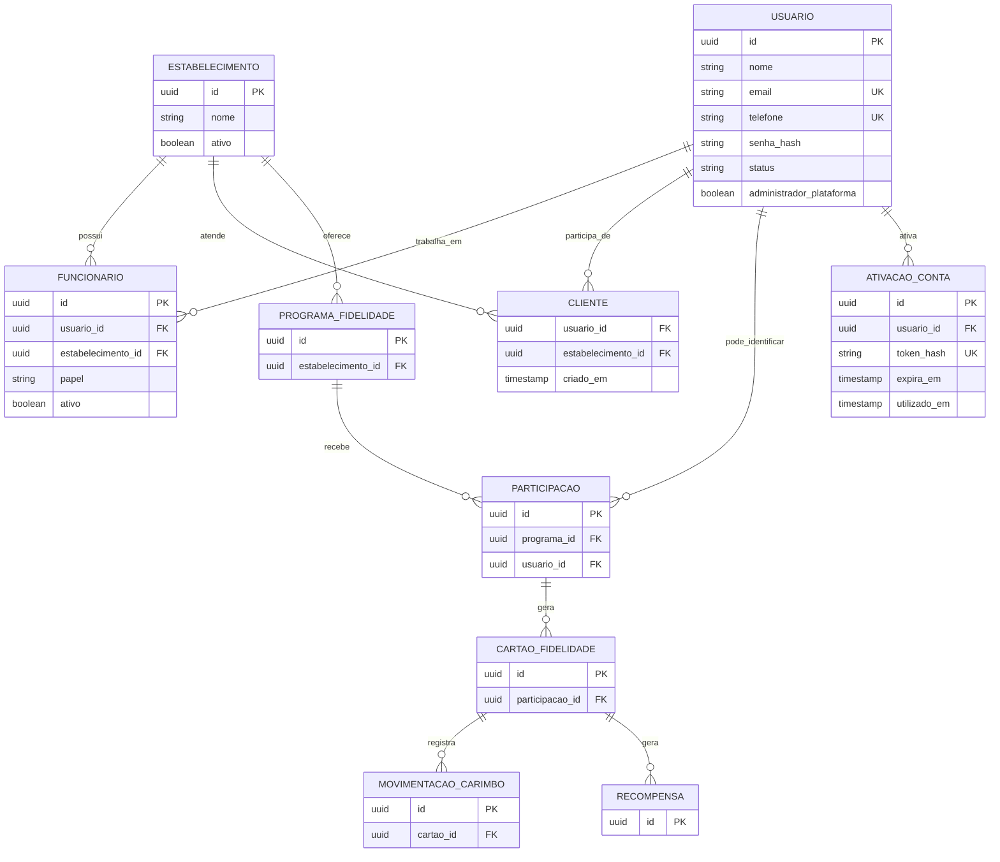

# LUVI Fideliza+ — revisão de modelagem para v0.10.0

**Base analisada:** código-fonte v0.9.1, migrações Flyway V1–V13.
**Estado:** proposta de arquitetura; NÃO é uma versão funcional v0.10.0.

## DER conceitual

## Mapeamento: estrutura atual → nomes mais claros

| Tabela atual | Nome conceitual | Observação |
|---|---|---|
| `usuario` | `usuario` | Pessoa única; credenciais e status de ativação |
| `membro_estabelecimento` | `funcionario` | Proprietário e funcionário são papéis do vínculo |
| `adesao_estabelecimento` | `cliente` | Cliente da loja, não uma pessoa duplicada |
| `estabelecimento` | `estabelecimento` | Loja |
| `programa_fidelidade` | `programa_fidelidade` | Campanhas e regras; avaliar terminologia existente |
| `participacao` | `participacao` | Adesão do cliente a cada programa |
| `cartao_fidelidade` | `cartao_fidelidade` | Ciclos e saldos |
| `movimentacao_carimbo` | `movimentacao_carimbo` | Registro auditável de carimbos |
| `recompensa` | `recompensa` | Prêmio e resgate |
| `convite_proprietario` e `convite_equipe` | `ativacao_conta` (novo) | Tokens únicos, expiração e uso único |

**Importante:** `cliente` (vínculo com estabelecimento) não é igual a `participacao` (vínculo com programa/campanha). Manter os dois conceitos evita perder o histórico dos cartões.

## Fluxos esperados da implementação

1. ADM cadastra estabelecimento e pré-cadastra proprietário numa única transação.
2. Proprietário pré-cadastra funcionário; funcionário autorizado pré-cadastra cliente.
3. Pré-cadastro cria `usuario` com status `PENDENTE_ATIVACAO` e vínculo correspondente; não cria senha conhecida pelo operador.
4. Token aleatório de uso único e 48 horas; somente hash armazenado. O link mostra nome e contato pré-cadastrados, sem pedir recadastro.
5. Usuário define senha e confirma; backend ativa a conta, invalida token e só então permite login.
6. Conta existente: exigir autenticação para aprovar vínculo, nunca assumir conta apenas por telefone/e-mail coincidente.
7. QR Code público segue permitindo adesão; evitar duplicação por restrição única de `(estabelecimento_id, usuario_id)`.
8. Envio via WhatsApp gera link HTTPS com mensagem; não faz envio automático. E-mail automático requer SMTP/provedor configurado.

## Política de migração

- **Não** alterar migrações V1–V13 já aplicadas.
- **Não** apagar tabelas, redefinir `flyway_schema_history` ou limpar usuários automaticamente.
- Primeiro implementar entidades, serviços, endpoints, telas e testes de integração em uma branch.
- Depois criar V14+ de migração incremental e executar com backup.
- Para deixar o pgAdmin legível desde já, há consultas de leitura em `CONSULTAS_PGADMIN.sql`.
